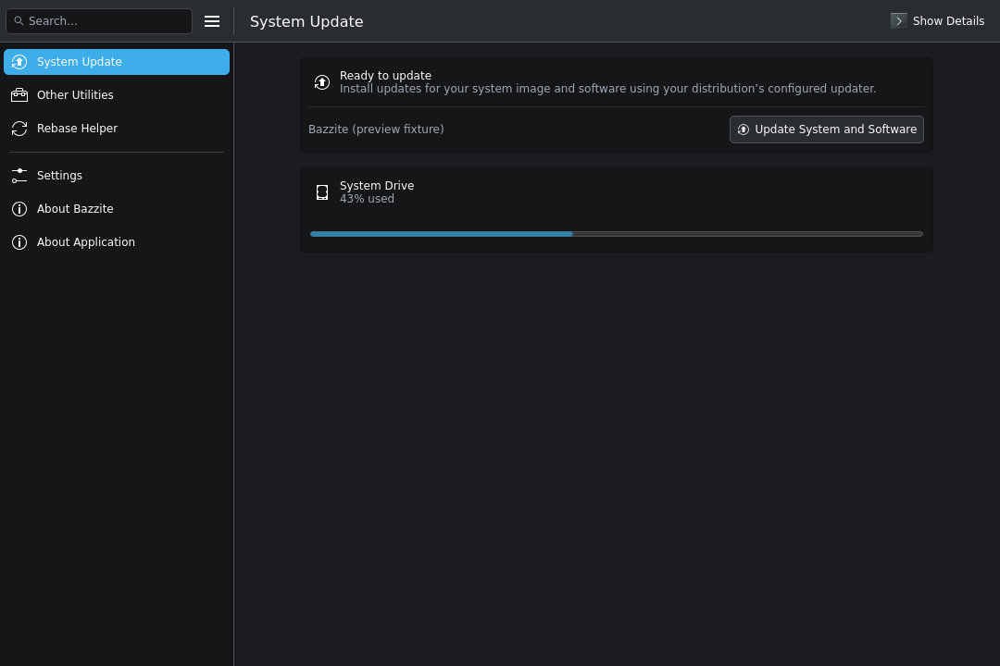

# Bazzite Updater KDE

> **ACTIVE DEVELOPMENT.** This independent desktop-focused fork is not accepting issues, feature requests, discussions, or pull requests. This participation policy does not change any free-software license rights.

A KDE Kirigami frontend for Bazzite's existing update, rollback, and rebase tools, based on [rfrench3/bazzite-updater](https://github.com/rfrench3/bazzite-updater). The upstream application is already Qt/Kirigami; this fork refines its desktop interaction rather than replacing the backend.



## Desktop changes

- Always-expanded sidebar with aligned native headers, without a redundant Navigation label.
- Info Center-style search for pages and features, plus a sidebar hamburger menu for Reboot System and Quit.
- Plain button and page names, even with a controller connected.
- Separate controller navigation state, so controller support does not depend on hiding the sidebar.
- A compact update page with one title, a clear update button, persistent status/error feedback, and Show Details / Hide Details.
- Actual booted-image identity from rpm-ostree/bootc, with the next-boot image shown separately. Inherited base-distribution metadata is explicitly labelled.
- A real mouse toggle for the application menu, including outside-click dismissal.
- A read-only Details log with an honest log-viewer icon, not a Konsole shell.
- Native KDE styling, fonts, colors, and accent during normal use.
- Keyboard-safe actions: Return does not start an update unless its button is focused. Ctrl+F focuses search, F10 opens the application menu, F12 toggles details, Escape dismisses search/details/dialogs, Ctrl+M switches navigation focus, and Ctrl+Q uses the normal guarded quit flow.

See [desktop design](docs/DESKTOP-DESIGN.md) for rationale and verification boundaries. The original [upstream README](README-upstream.md) is retained for background, not as installation instructions for this fork.

## Build

Use a matched Qt 6 / KDE Frameworks development environment. CMake lists the required Qt, KF6, Kirigami Addons, and SDL3 versions. Do not mix arbitrary Qt wheels or SDKs with unrelated host QML modules.

```sh
git submodule update --init --recursive
cmake -S . -B build -G Ninja \
  -D_INCLUDE_SUBMODULES=ON \
  -D_USE_XDG_CONFIG=ON \
  -DCMAKE_INSTALL_PREFIX="$PWD/build/install-root"
cmake --build build
```

The controller dependency is pinned to the upstream submodule commit. `_USE_XDG_CONFIG=ON` stages configuration below the chosen prefix; it does not authorize replacing the host's system configuration. Normal application startup still prefers the distribution's trusted `/etc` and `/usr/etc` configuration.

The fork identifies itself as `1.2.1-kde.3` while retaining upstream numeric build version `1.2.1`. It preserves the `bazzite-updater` executable, application ID, translation domain, and system-configuration paths for downstream compatibility. Do not install it alongside an overlapping upstream package without an explicit packaging/rollback plan. No new stable release, desktop installation, or james-os integration is implied by a successful source build.

## Verify

```sh
python3 -m unittest discover -s tests -p 'test_*.py' -v
cmake -S . -B build-test -G Ninja \
  -D_INCLUDE_SUBMODULES=ON -D_USE_XDG_CONFIG=ON \
  -DBAZZITE_UPDATER_UI_PROBE=ON \
  -DCMAKE_INSTALL_PREFIX="$PWD/build-test/install-root"
cmake --build build-test
bash tests/run-ui-probe.sh "$PWD/build-test" "$PWD/evidence"
```

The opt-in probe renders real Qt/Kirigami windows offscreen, checks search, application-menu placement and commands, navigation, controller-label independence, keyboard actions, dialog cancellation, disabled controls, repeated page changes, error/running states, narrow windows, and larger text. It produces JSON reports and screenshots with synthetic display data. Command execution is blocked in this build, including command-line update/rollback. **Never distribute the probe executable.** Normal builds leave `BAZZITE_UPDATER_UI_PROBE=OFF`.

Source-contract tests and native UI tests are intentionally distinct from real system-update testing. Physical controllers, screen readers, RTL, Gamescope, live desktop theme changes, and full backend update integration remain unverified. Native packages and desktop startup are verified separately against the runtime recorded with each release. See [verification](docs/VERIFICATION.md) for the exact tested revision and warnings.

## Contributing and licensing

Contributions are currently closed; see [CONTRIBUTING.md](CONTRIBUTING.md). The public repository keeps pull requests, issues, and discussions disabled, without archiving development.

Upstream history, copyright notices, and licenses are preserved. Application code is generally GPL-2.0-or-later, with file-specific license choices retained. See [THIRD_PARTY_NOTICES.md](THIRD_PARTY_NOTICES.md) and [LICENSES](LICENSES). This is not an official Bazzite, Universal Blue, or KDE release.
